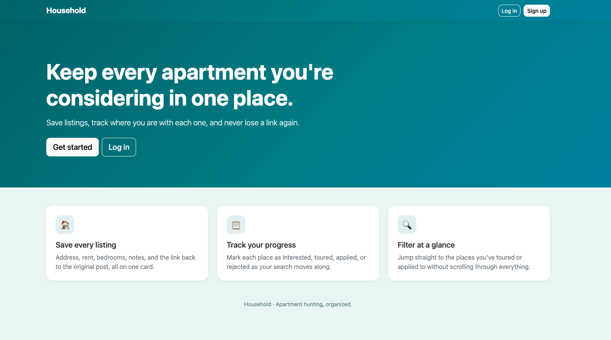

# 🏠 Household

**Keep every apartment you're considering in one place.**

Household is a full-stack apartment hunting tracker where users can save listings, track where they stand with each one, and keep notes and links from their search organized in a single dashboard.

Built with Node.js, Express, MongoDB, and EJS, Household integrates the Unsplash API to automatically add a photo to each saved listing.

## 🔗 Live Application

[Explore Household](#) <!-- replace # with your deployed link -->

## 📸 Project Preview



## Features

- **User Authentication:** Sign up, log in, and log out with a private account.
- **Save Listings:** Add apartments with an address, rent, bedrooms, listing link, and personal notes.
- **Automatic Photos:** Pulls an apartment photo from Unsplash for each new listing, or lets you paste your own image URL.
- **Status Tracking:** Mark each place as Interested, Toured, Applied, or Rejected.
- **Status Filter:** Narrow your dashboard to just the listings in a given stage.
- **Edit & Delete:** Update or remove any of your listings at any time.
- **Private by Design:** Every listing belongs to its owner, and edit and delete actions are checked against the logged-in user so nobody can touch someone else's data.
- **Responsive Design:** Blue-green themed interface that works on desktop and mobile.

## Tech Stack

### Frontend
- HTML5
- CSS3
- Bootstrap 5
- EJS

### Backend
- Node.js
- Express.js
- MongoDB
- Mongoose
- Passport.js (local authentication)

### APIs & Tools
- Unsplash API
- MongoDB Atlas

## Credits & Acknowledgments

- **[Bootstrap 5 Gallery Grid – FreeFrontend](https://freefrontend.com/bootstrap-cards/#2025-01-01-bootstrap-5-gallery-grid-l)**: The image-overlay card style for listings was inspired by this design, reworked into a uniform grid with a custom blue-green theme.
- **[Bootstrap Signup Form Snippet – BootstrapBrain](https://bootstrapbrain.com/component/bootstrap-signup-form-snippet/)**: The login and signup pages were adapted from this snippet and restyled to match Household.
- **[Unsplash API](https://unsplash.com/developers)**: Provides the apartment photos. Each photo credits its photographer and Unsplash on the listing card.
- The server and routes were self written, while automated assistance was used to help develop some of the EJS pages and CSS. The login/signup styling was also adapted from the FreeFrontend design credited above.

## How It Works

1. **Create an account** to start your apartment search.
2. **Add a listing** with its address, rent, bedrooms, link, and notes.
3. **A photo is added automatically** from Unsplash, or you can paste your own image URL.
4. **Update the status** as you move from interested to toured to applied.
5. **Filter your dashboard** by status to focus on what matters right now.
6. **Edit or delete** listings as your search changes.

## Running Locally

1. Clone the repository and install dependencies:
   ```bash
   npm install
   ```
2. Create a `.env` file in the project root with your own values:
   ```
   MONGODB_URI=your-mongodb-connection-string
   SESSION_SECRET=any-long-random-phrase
   UNSPLASH_ACCESS_KEY=your-unsplash-access-key
   ```
3. Start the server and visit `http://localhost:8080`:
   ```bash
   node server.js
   ```

## Future Improvements

- Sort listings by rent, bedrooms, or most recently added.
- Compare two or three listings side by side.
- Add a summary of total listings and average rent.
- Allow editing a listing's photo.
- Upgrade to the latest versions of Mongoose, Passport, and bcrypt.